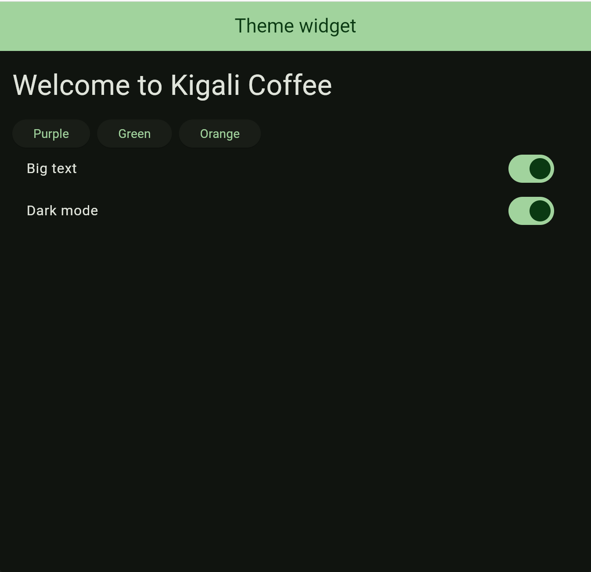

# Theme Widget Demo
A Flutter theme controls the overall appearance of an app, including its colors, text styles, and brightness (light or dark mode).
## How to Run
You need Flutter installed on your computer.
- flutter pub get
- flutter run -d chrome or if you have an emulator run this command: flutter run and you’ll see available devices then choose one you want to run on your app or to makesure that the device you want is the one that is selected you run flutter run -d device_id.
## The Three Attributes
### 1. colorScheme
- Default value: Deep Purple, created using Colors.deepPurple.
- What I changed: I selected Green and Orange using the buttons, and the app's color scheme updated on the screen.
- Why a developer would change it: To match the app's branding and maintain consistent colors across the interface without manually styling every widget.
### 2. textTheme
- Default value: Font size 16 for bodyMedium.
- What I changed: I enabled Big Text, increasing the bodyMedium font size from 16 to 32.
- Why a developer would change it: To improve readability and make text easier to see for users who prefer larger fonts.
### 3. brightness
- Default value: Light mode (Brightness.light).
- What I changed: I enabled Dark Mode, and the app switched to a dark color scheme.
- Why a developer would change it: To support user preferences and make the interface more comfortable to view in low-light environments.
## Screenshot
